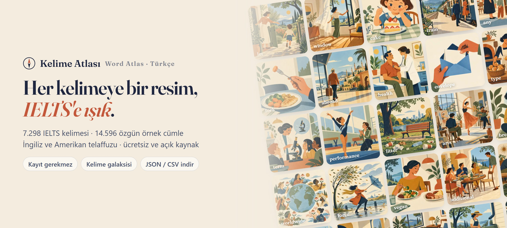
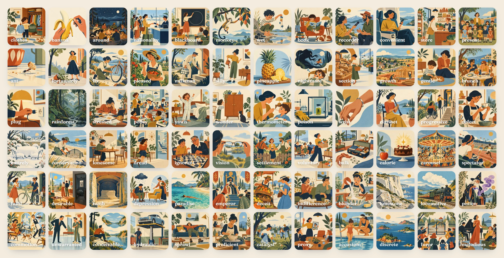
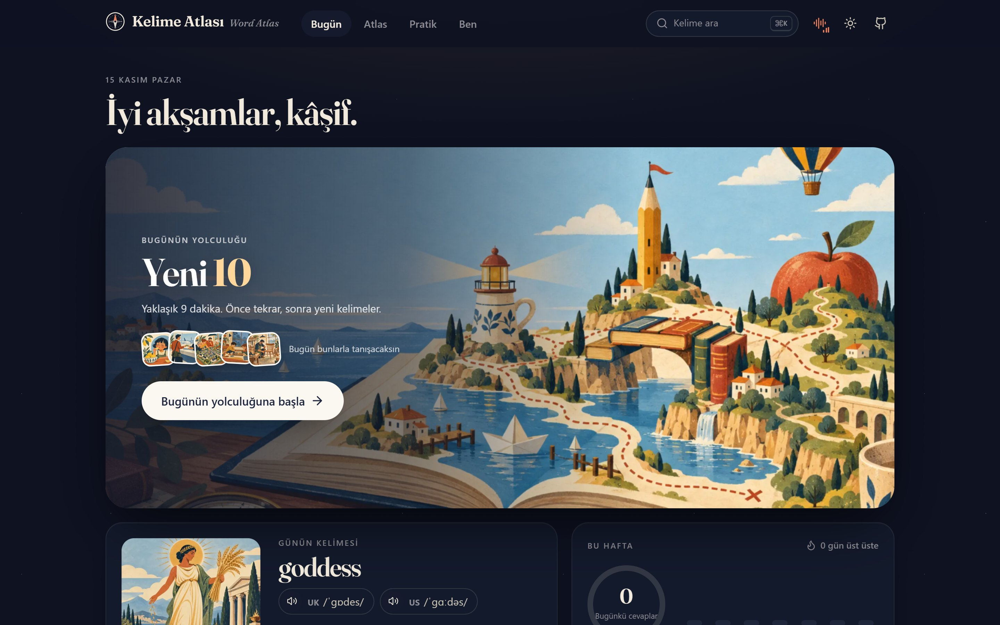
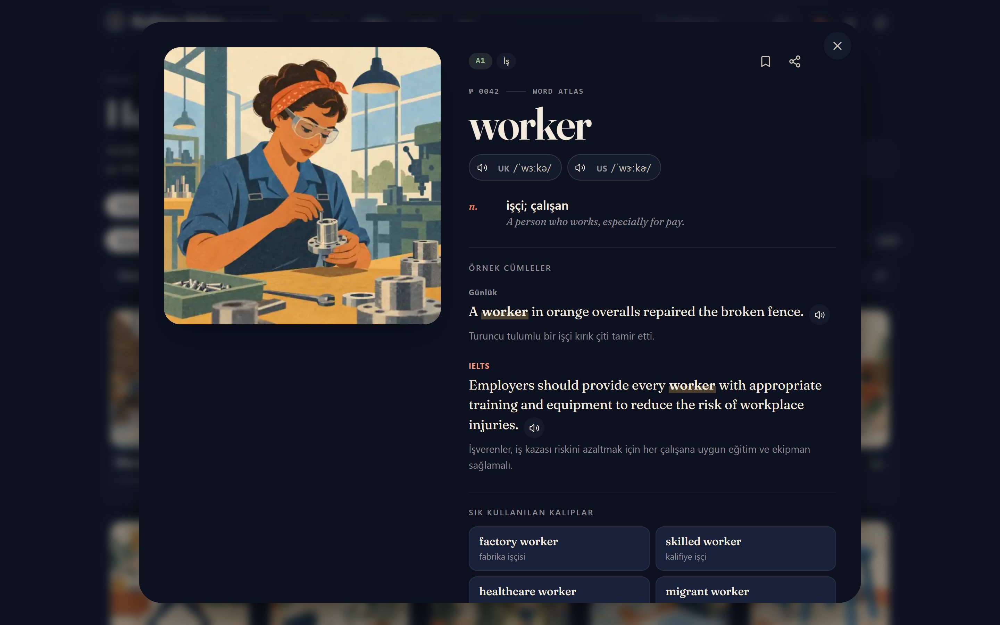
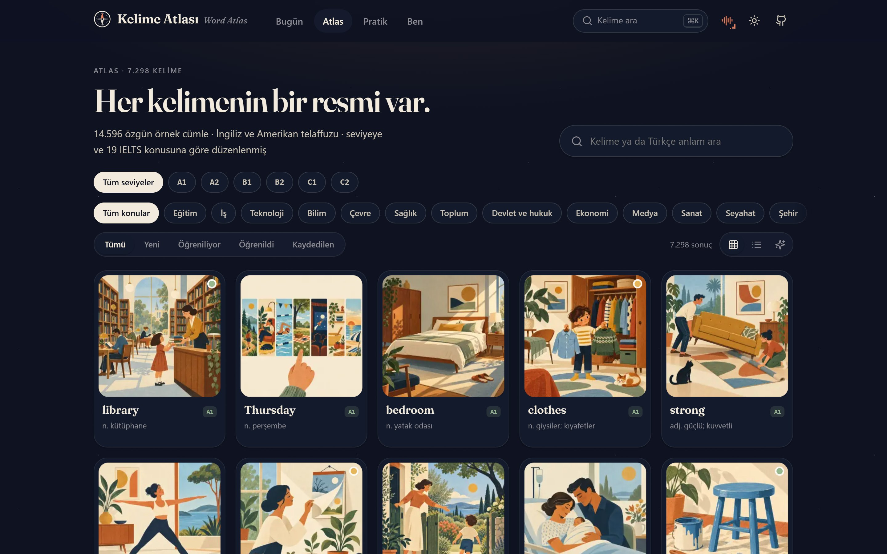
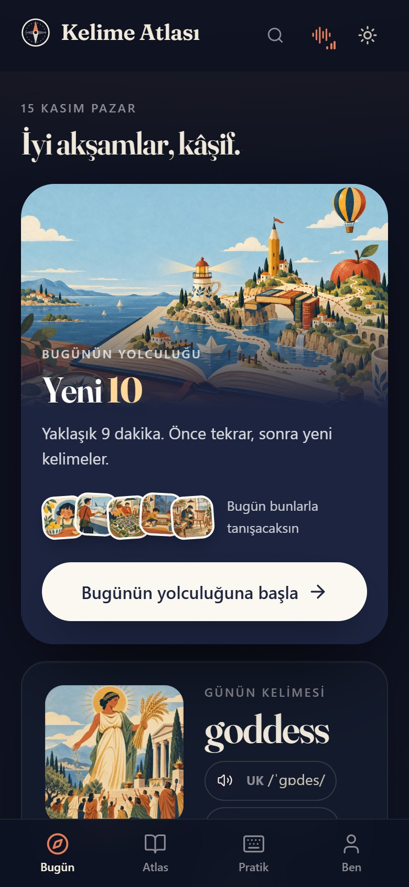
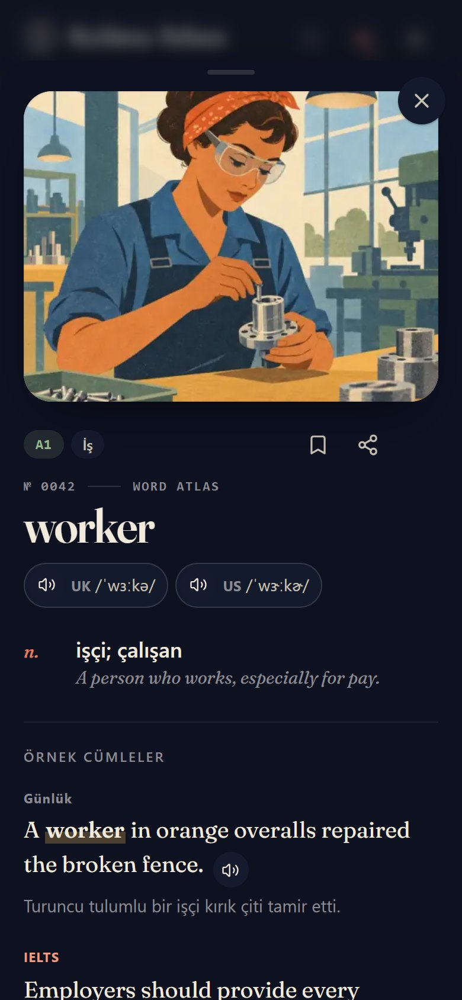
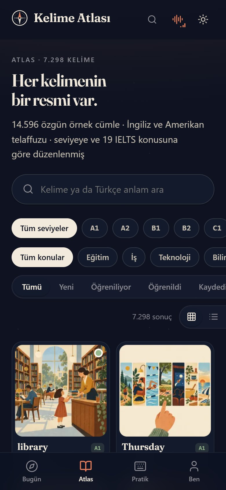

<div align="center">



# Kelime Atlası

**See the word. Hear it. Make it yours.**

*The Turkish–English edition of Word Atlas, an illustrated IELTS vocabulary app*

7,298 IELTS words · Original illustrations · UK and US audio · Spaced repetition

[**Try it live ↗**](https://esedmemmed.github.io/kelime-atlasi/) · [Get the dataset](data/) · [Türkçe README](README.md)

[](LICENSE)
[](CONTENT_LICENSE.md)

</div>

---

Kelime Atlası helps Turkish speakers learn English IELTS vocabulary. Every word comes with a picture, Turkish meanings, two examples, collocations and a pronunciation you can hear in UK or US English. You practise active recall and come back to words on an FSRS spaced-repetition schedule. It is free, needs no account, works on a phone, and keeps your progress on your device.

This is the Turkish edition of [Word Atlas](https://github.com/designfuchen/word-atlas) by designfuchen. The whole interface and all learning text are in Turkish. The English content, illustrations and UK/US audio come from the original project.

**Live site: https://esedmemmed.github.io/kelime-atlasi/**

[What's inside](#whats-inside) · [Screenshots](#screenshots) · [How it was translated](#how-it-was-translated) · [Dataset](#dataset) · [Run locally](#run-locally) · [Contributing](#contributing) · [License and credits](#license-and-credits)

## What's inside

**Content**

- **7,298 IELTS words**, CEFR A1 to C2, across 19 IELTS topics
- **14,596 original example sentences**, two per word
- **24,722 collocations**, each with its Turkish meaning

**Media**

- One **original illustration** for every word
- **UK and US audio** for every word and every example

**Learning**

- **FSRS spaced repetition**, scheduled from your own history
- A **galaxy** star map that fills with the words you have learned
- Free, no sign-up, mobile friendly, offline media cache

**The Turkish edition**

- The whole UI is in Turkish.
- Every word has Turkish meanings, Turkish translations of both examples, the Turkish meaning of each collocation, and a usage tip written for Turkish speakers.
- Search works with an English word or a Turkish meaning, and ignores diacritics: typing `kutuphane` finds *library*.
- The spoken voice lines are in Turkish (edge-tts).

## Screenshots



### Desktop



<table>
<tr>
<td width="50%"></td>
<td width="50%"></td>
</tr>
<tr><td align="center">A scene for every word</td><td align="center">The atlas</td></tr>
</table>

### Mobile

<table>
<tr>
<td width="33%"></td>
<td width="33%"></td>
<td width="33%"></td>
</tr>
<tr><td align="center">Today</td><td align="center">Word card</td><td align="center">Atlas</td></tr>
</table>

<sub>Actual screenshots of the app. The banner is a conceptual brand illustration.</sub>

## Learning loop

| Step | What you do |
| :--- | :--- |
| **See** | Look at the illustration, the Turkish meanings, two original examples, collocations and a usage tip. |
| **Hear** | Switch between UK and US pronunciation and listen to the examples. |
| **Recall** | Practise meaning to word, illustrated cloze, listening recognition and spelling. |
| **Review** | FSRS schedules reviews from your history. Only the first answer counts toward accuracy. |
| **Keep** | Track progress in the galaxy, practise typing separately, and export or restore your local progress. |

## How it was translated

The Turkish text is AI translation reviewed by AI, and we want to be upfront about that.

1. **Translation:** Claude Haiku 5.5 translated from the English definitions and examples. The original Chinese was given only as a hint for which sense is meant.
2. **Review:** Claude Sonnet 5.5 then reviewed every entry and corrected 3,343 fields.
3. **Automated QA:** scripts check counts, empty fields, untranslated examples, length limits and duplicate ids.

No human translator has read every entry, so mistakes are likely to remain. If you spot one, please [open an issue](https://github.com/esedmemmed/kelime-atlasi/issues/new/choose) or send a pull request with the fix. Details and tooling: [docs/turkish-edition.md](docs/turkish-edition.md).

This is not an official IELTS word list, is not affiliated with the IELTS partners, and does not promise a higher score.

## Dataset

| File | Contents |
| :--- | :--- |
| [`data/word-atlas-tr.json`](data/word-atlas-tr.json) | The Turkish–English dataset, 7,298 entries |
| [`data/word-atlas-tr.csv`](data/word-atlas-tr.csv) | The same data as CSV, handy for Anki and spreadsheets |
| [`data/source/`](data/source/) | The original English–Chinese source data and media flags |

See the [data dictionary](docs/dataset.md) for the fields. The dataset is shared under CC BY 4.0.

```python
import json
from pathlib import Path

words = json.loads(Path("data/word-atlas-tr.json").read_text(encoding="utf-8"))
b2_environment = [w for w in words if w["cefr"] == "B2" and w["topic"] == "environment"]
```

## Run locally

You need **Node.js 20+** and npm. The repository includes all images and audio, so the first clone takes a while.

```bash
git clone https://github.com/esedmemmed/kelime-atlasi.git
cd kelime-atlasi
npm ci
npm run dev
```

Then open **http://localhost:5188**.

```bash
npm test             # unit tests
npm run check:atlas  # dataset and media validation
npm run build        # production build in dist/
```

Deployment: `.github/workflows/pages.yml` publishes the site to GitHub Pages on every push to `main`. See the [deployment guide](docs/deployment.md).

**Stack:** React 19 · TypeScript · Vite · ts-fsrs · WebGL2

## Contributing

When reporting a problem, include the **word ID, how to reproduce it and the expected result**. For translation fixes, a reliable dictionary reference helps a lot.

- [Report an issue](https://github.com/esedmemmed/kelime-atlasi/issues/new/choose)
- [Contribution guide](CONTRIBUTING.md)
- [Security policy](SECURITY.md)
- [Developer notes on the Turkish edition](docs/turkish-edition.md)

## License and credits

| Scope | License |
| :--- | :--- |
| Application code | [MIT](LICENSE) |
| Word data, illustrations and audio | [CC BY 4.0](CONTENT_LICENSE.md) |
| Dependencies and fonts | Their own licenses |

**Attribution:** Word Atlas contributors (词光), adapted by Kelime Atlası contributors (Turkish edition, 2026), CC BY 4.0. Thanks to [@designfuchen](https://github.com/designfuchen) and everyone who built the original Word Atlas. In this edition the English content, illustrations and UK/US audio come from the original project; the Turkish text and interface are new.
