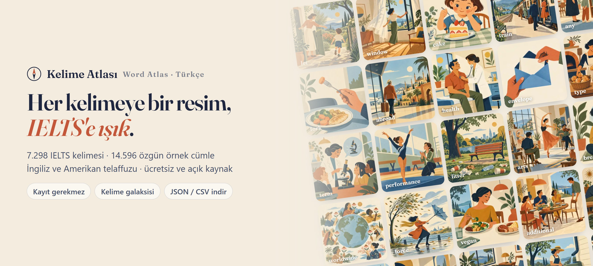
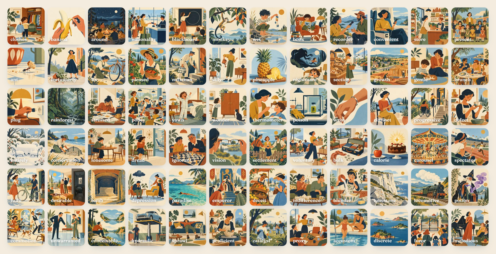
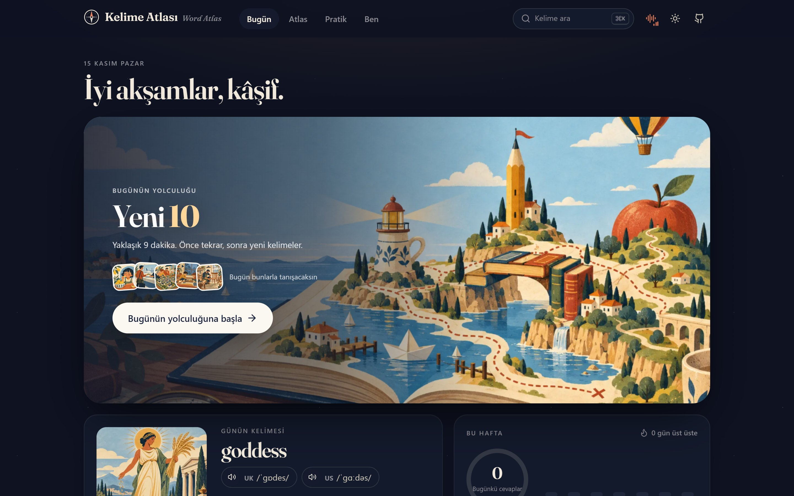
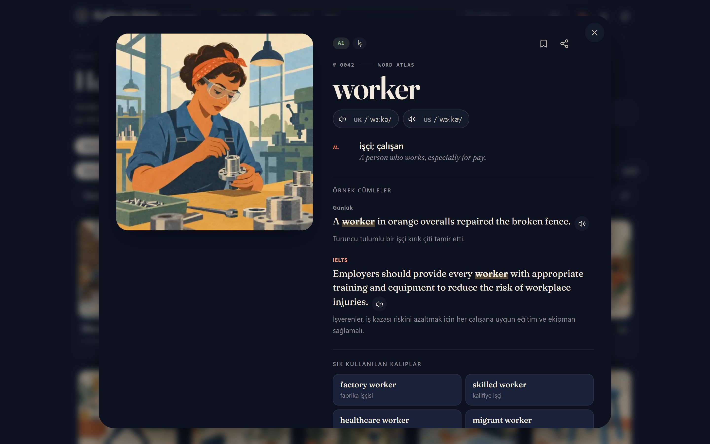
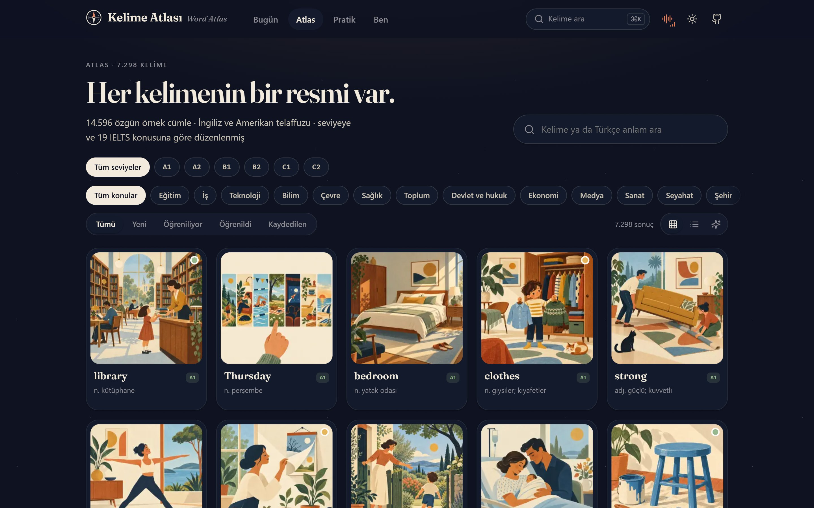
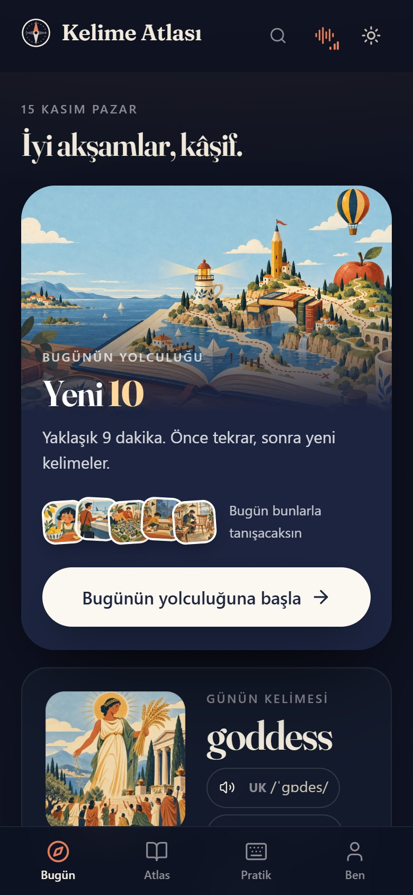
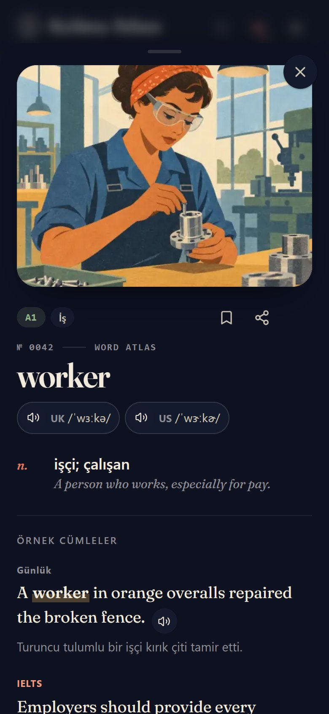
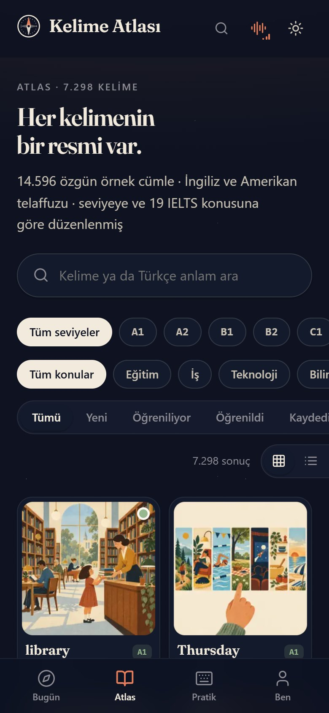

<div align="center">



# Kelime Atlası

**Kelimeyi gör, dinle, senin olsun.**

7.298 IELTS kelimesi · Özgün resimler · İngiliz ve Amerikan telaffuzu · Aralıklı tekrar

[**Hemen dene ↗**](https://esedmemmed.github.io/kelime-atlasi/) · [Veri setini indir](data/) · [English README](README.en.md)

[](LICENSE)
[](CONTENT_LICENSE.md)

</div>

---

Kelime Atlası, İngilizce öğrenen Türkçe konuşanlar için resimli bir IELTS kelime uygulamasıdır. Kelimeleri sahnelerle ve telaffuzla bağlar, aktif hatırlamayla pekiştirir ve FSRS aralıklı tekrarıyla zamanında önünüze getirir. Ücretsizdir, kayıt gerektirmez, telefonda çalışır. İlerlemeniz cihazınızda kalır. İsterseniz bir QR koduyla telefonunuz ve bilgisayarınız arasında uçtan uca şifreli olarak eşitlenir.

Bu proje, designfuchen'in açık kaynaklı [Word Atlas](https://github.com/designfuchen/word-atlas) çalışmasının Türkçe baskısıdır. Arayüz ve tüm öğrenme metni Türkçeye çevrildi; İngilizce içerik, resimler ve sesler özgün projeden gelir.

**Canlı site: https://esedmemmed.github.io/kelime-atlasi/**

[İçindekiler](#neler-var) · [Ekran görüntüleri](#ekran-görüntüleri) · [Çeviri nasıl yapıldı](#çeviri-nasıl-yapıldı) · [Veri](#veri-seti) · [Yerelde çalıştırma](#yerelde-çalıştırma) · [Katkı](#katkıda-bulunma) · [Lisans](#lisans-ve-teşekkür)

## Neler var

**İçerik**

- **7.298 IELTS kelimesi**, CEFR A1'den C2'ye, 19 IELTS konusunda
- **14.596 özgün örnek cümle** (her kelime için iki tane)
- **24.722 eşdizim** (collocation), her birinin Türkçe karşılığıyla

**Medya**

- Her kelime için bir **özgün resim**
- Her kelime ve her örnek için **İngiliz ve Amerikan sesi**

**Öğrenme**

- **FSRS aralıklı tekrar**: tekrarlar geçmişinize göre planlanır
- **Galaksi**: öğrendiğiniz kelimelerin yıldızlarla dolduğu bir yıldız haritası
- Ücretsiz, kayıt yok, mobilde çalışır, çevrimdışı medya önbelleği

**Türkçe baskı**

- Arayüzün tamamı Türkçe.
- Her kelimede Türkçe anlamlar, iki örneğin Türkçe çevirisi, her eşdizimin Türkçe karşılığı ve Türkçe konuşanlar için yazılmış bir kullanım ipucu vardır.
- Arama İngilizce kelimeyle ya da Türkçe anlamla çalışır ve aksan duyarsızdır: `kutuphane` yazınca *library* bulunur.
- Sesli yönlendirmeler Türkçedir (edge-tts).

## Ekran görüntüleri



### Masaüstü



<table>
<tr>
<td width="50%"></td>
<td width="50%"></td>
</tr>
<tr><td align="center">Her kelime için bir sahne</td><td align="center">Kelime atlası</td></tr>
</table>

### Mobil

<table>
<tr>
<td width="33%"></td>
<td width="33%"></td>
<td width="33%"></td>
</tr>
<tr><td align="center">Bugün</td><td align="center">Kelime kartı</td><td align="center">Atlas</td></tr>
</table>

<sub>Görüntüler uygulamanın gerçek ekranlarıdır; afiş kavramsal bir marka çizimidir.</sub>

## Öğrenme döngüsü

| Adım | Ne yaparsınız |
| :--- | :--- |
| **Gör** | Resme, Türkçe anlama, iki özgün örneğe, eşdizimlere ve kullanım ipucuna bakın. |
| **Dinle** | İngiliz ve Amerikan telaffuzu arasında geçin, örnek cümleleri dinleyin. |
| **Hatırla** | Anlamdan kelimeyi bulma, resimli boşluk doldurma, dinleyerek tanıma ve yazım alıştırmaları yapın. |
| **Tekrar et** | FSRS tekrarları geçmişinize göre planlar. Doğruluğa yalnızca ilk yanıt sayılır. |
| **Koru** | İlerlemenizi galakside izleyin, yazmayı ayrıca çalışın, ilerlemenizi dışa aktarıp geri yükleyin. |

## Çeviri nasıl yapıldı

Türkçe metin yapay zekayla üretildi ve yine yapay zekayla gözden geçirildi. Bunu açıkça söylemek isteriz.

1. **Çeviri:** Claude Haiku 5.5, İngilizce tanımlardan ve örneklerden çeviri yaptı. Çince yalnızca anlam ayrımı için ipucu olarak verildi.
2. **Gözden geçirme:** Her girdiyi Claude Sonnet 5.5 baştan sona inceledi ve 3.343 alanı düzeltti.
3. **Otomatik kontrol:** Sayılar, boş alanlar, çevrilmemiş örnekler, uzunluk sınırları ve yinelenen kimlikler betikle denetlendi.

Bir insan çevirmen her girdiyi tek tek okumadı, bu yüzden hatalar olabilir. Bir hata görürseniz lütfen [issue açın](https://github.com/esedmemmed/kelime-atlasi/issues/new/choose) ya da düzeltmeyi pull request olarak gönderin. Ayrıntılar: [docs/turkish-edition.md](docs/turkish-edition.md).

Bu IELTS resmi bir kelime listesi değildir ve IELTS sınavını düzenleyen kurumlarla bağlantısı yoktur. Puan artışı vaat etmez.

## Veri seti

| Dosya | İçerik |
| :--- | :--- |
| [`data/word-atlas-tr.json`](data/word-atlas-tr.json) | Türkçe–İngilizce veri seti, 7.298 girdi |
| [`data/word-atlas-tr.csv`](data/word-atlas-tr.csv) | Aynı veri, CSV olarak (Anki ve tablolar için) |
| [`data/source/`](data/source/) | Özgün İngilizce–Çince kaynak veri ve medya bilgisi |

Alanlar için [veri sözlüğüne](docs/dataset.md) bakın. Veri CC BY 4.0 ile paylaşılır.

```python
import json
from pathlib import Path

words = json.loads(Path("data/word-atlas-tr.json").read_text(encoding="utf-8"))
b2_environment = [w for w in words if w["cefr"] == "B2" and w["topic"] == "environment"]
```

## Yerelde çalıştırma

Node.js 20+ ve npm gerekir. Depo tüm resim ve ses dosyalarını içerir, bu yüzden ilk indirme biraz sürer.

```bash
git clone https://github.com/esedmemmed/kelime-atlasi.git
cd kelime-atlasi
npm ci
npm run dev
```

Sonra **http://localhost:5188** adresini açın.

```bash
npm test             # birim testleri
npm run check:atlas  # veri ve medya doğrulaması
npm run build        # dist/ içine üretim derlemesi
```

Dağıtım: `.github/workflows/pages.yml` her `main` gönderiminde siteyi GitHub Pages'e yayınlar. Ayrıntılar: [dağıtım rehberi](docs/deployment.md).

**Teknolojiler:** React 19 · TypeScript · Vite · ts-fsrs · WebGL2

## Katkıda bulunma

Bir sorun bildirirken **kelime kimliğini, nasıl görüldüğünü ve beklenen sonucu** yazın. Çeviri düzeltmeleri için güvenilir bir sözlük kaynağı eklemeniz çok yardımcı olur.

- [Sorun bildir](https://github.com/esedmemmed/kelime-atlasi/issues/new/choose)
- [Katkı rehberi](CONTRIBUTING.md)
- [Güvenlik politikası](SECURITY.md)
- [Türkçe baskının geliştirici notları](docs/turkish-edition.md)

## Lisans ve teşekkür

| Kapsam | Lisans |
| :--- | :--- |
| Uygulama kodu | [MIT](LICENSE) |
| Kelime verisi, resimler ve sesler | [CC BY 4.0](CONTENT_LICENSE.md) |
| Bağımlılıklar ve yazı tipleri | Kendi lisansları |

**Atıf:** Word Atlas contributors (词光), uyarlayan: Kelime Atlası contributors (Türkçe baskı, 2026), CC BY 4.0. Özgün Word Atlas'ı yapan [@designfuchen](https://github.com/designfuchen)'e ve katkıda bulunanlara teşekkürler. Bu baskıda İngilizce içerik, resimler ve İngiliz/Amerikan sesleri özgün projeden alınmıştır; Türkçe metin ve arayüz bu baskıya aittir.
